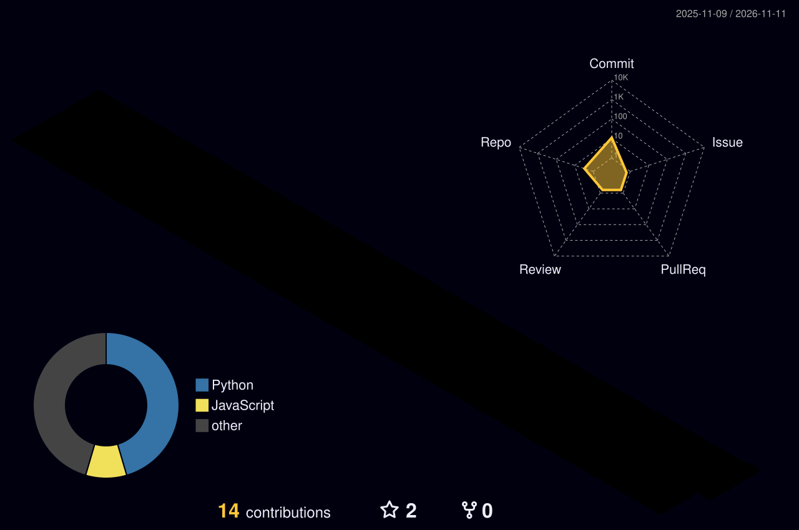

<!-- ==================== CYBERPUNK NEURAL LAB HEADER BANNER ==================== -->
<div align="center">
  
</div>

<!-- ==================== DYNAMIC NEON TYPING SVG ==================== -->
<p align="center">
  <a href="https://git.io/typing-svg">
    
  </a>
</p>

<!-- ==================== STATUS & CONNECT PILLS ==================== -->
<p align="center">
  
  &nbsp;
  
  &nbsp;
  <a href="mailto:rijulbhattacharjee@gmail.com">
    
  </a>
  &nbsp;
  <a href="https://github.com/rjb2k61" target="_blank">
    
  </a>
  <!-- Uncomment once LinkedIn is created:
  &nbsp;
  <a href="https://www.linkedin.com/in/YOUR_LINKEDIN" target="_blank">
    
  </a>
  -->
</p>

<br>

<!-- ==================== SIDE-BY-SIDE ABOUT ME + 3D NEURAL TESSERACT ==================== -->
## 🧬 Neural Profile & Architecture

<table>
<tr>
<td width="58%" valign="top">

```python
class AIMLEngineer:
    def __init__(self):
        self.name = "Rijul Bhattacharjee"
        self.education = "B.Tech in AIML (2nd Year) @ CMRIT, Bengaluru 🇮🇳"
        self.availability = "🟢 Open to Work: AI/ML, GenAI, MLOps & Research Roles"

        self.specializations = [
            "Generative AI & LLM Engineering (Hybrid RAG, LangGraph Agents)",
            "Parameter-Efficient Fine-Tuning (PEFT / LoRA / QLoRA / vLLM)",
            "End-to-End MLOps (Docker, FastAPI, MLflow, W&B, DVC, CI/CD)",
            "Deep Learning Research & Explainable Computer Vision (Grad-CAM)"
        ]

        self.stack = {
            "languages":  ["Python", "Java", "SQL", "Bash"],
            "genai_llm":  ["PyTorch", "HuggingFace", "LangGraph", "LlamaIndex", "FAISS/Qdrant"],
            "java_back":  ["Java", "Spring Boot", "Maven", "Gradle", "REST Microservices"],
            "mlops_sys":  ["Docker", "FastAPI", "MLflow", "W&B", "DVC", "GitHub Actions"],
            "vision_ml":  ["YOLOv8", "OpenCV", "Scikit-Learn", "NumPy", "Pandas"]
        }

    def mission(self) -> str:
        return "Bridging foundational AI research and fault-tolerant production MLOps."
```

<br>


</td>

<td width="42%" align="center" valign="middle">



</td>
</tr>
</table>

<br>

<!-- ==================== OPINIONATED TECH STACK & ARSENAL ==================== -->
## ⚡ Engineering & Research Arsenal

<p align="center">
  
</p>

<p align="center">
  
  
  
  
  
  
  
  
  
</p>

<p align="center">
  
  
  
  
  
  
  
  
</p>

<br>

<!-- ==================== BENTO 2x2 FLAGSHIP PROJECTS & FOCUS LABS ==================== -->
## 🚀 Flagship Systems & Research Focus

<table>
<tr>
<td width="50%" valign="top">

### 🛣️ [RoadWatch — Explainable Pothole Detection AI](https://github.com/rjb2k61/Roadwatch---An-AI-powered-pothole-detection-system)
> **Two-Stage Deep Learning & Automated Civic Severity Engine**
- **Stage 1 (Explainable Classification):** Transfer-learned **MobileNetV2** with **Grad-CAM** visual saliency heatmaps to verify road surface anomalies
- **Stage 2 (Object Localisation):** Fine-tuned **YOLOv8** bounding-box detector computing relative surface damage ratios (`Low < 2%`, `Medium 2–8%`, `High > 8%`)
- Extracts **EXIF GPS telemetry** onto interactive Folium maps and exports automated **PDF/CSV** civil inspection reports

`PyTorch` · `YOLOv8` · `Grad-CAM` · `OpenCV` · `Streamlit`

</td>
<td width="50%" valign="top">

### 🤖 [GenAI & Agentic LLM Systems Lab](https://github.com/rjb2k61)
> **Multi-Agent Graph Orchestration, Hybrid RAG & PEFT**
- Designing stateful multi-agent reasoning loops with **LangGraph** and tool-calling verification
- Hybrid retrieval pipelines combining dense vector embeddings (**Qdrant / FAISS**) with cross-encoder re-ranking and **Ragas** faithfulness evaluation
- Parameter-Efficient Fine-Tuning (**LoRA / QLoRA**) of open-weights LLMs on consumer GPUs

`HuggingFace` · `LangGraph` · `PEFT / LoRA` · `Vector DBs` · `Pydantic`

</td>
</tr>

<tr>
<td width="50%" valign="top">

### ⚙️ [Scalable MLOps & Inference Infrastructure](https://github.com/rjb2k61)
> **Reproducible Training, Model Registries & Containerized Serving**
- End-to-end data & model lineage using **DVC (Data Version Control)**, **MLflow**, and **Weights & Biases** experiment tracking
- Low-latency asynchronous model serving via **FastAPI** and **Docker** microservices with automated CI/CD/CT workflows via **GitHub Actions**
- Focus on drift detection, quantization, and reproducible ML pipelines

`Docker` · `FastAPI` · `MLflow` · `W&B` · `DVC` · `GitHub Actions`

</td>
<td width="50%" valign="top">

### 🔬 [Deep Learning & AI Research Explorations](https://github.com/rjb2k61)
> **Architecture Implementations, Model Alignment & Explainability**
- Implementing core deep learning papers from scratch in **PyTorch** (Attention mechanisms, Vision Transformers, and efficient inference)
- Investigating model interpretability (**Grad-CAM / Attention Rollout**), quantization trade-offs, and domain adaptation on real-world datasets
- Open to academic research collaborations & research internships

`PyTorch` · `Transformers` · `Explainable AI (XAI)` · `ArXiv Reproductions`

</td>
</tr>
</table>

<br>

<!-- ==================== 3D ISOMETRIC CONTRIBUTION CITY ==================== -->
## 🏙️ 3D Isometric Contribution City

<p align="center">
  <picture>
    <source media="(prefers-color-scheme: dark)" srcset="https://raw.githubusercontent.com/rjb2k61/rjb2k61/main/profile-3d-contrib/profile-night-rainbow.svg">
    <source media="(prefers-color-scheme: light)" srcset="https://raw.githubusercontent.com/rjb2k61/rjb2k61/main/profile-3d-contrib/profile-night-green.svg">
    
  </picture>
</p>

<br>

<!-- ==================== 5-CARD GITHUB ANALYTICS DASHBOARD ==================== -->
## 📊 GitHub Telemetry & Analytics

<p align="center">
  
</p>

<p align="center">
  
  
</p>

<p align="center">
  
  
</p>

<br>

<!-- ==================== PROFILE SUMMARY COUNTERS & FOOTER ==================== -->
## 📋 Live Profile Counters

<p align="center">
  
</p>

<p align="center">
  
  &nbsp;&nbsp;&nbsp;&nbsp;
  
  &nbsp;&nbsp;&nbsp;&nbsp;
  
</p>

<p align="center">
  ⚡ <b>Connect with <a href="https://github.com/rjb2k61">Rijul Bhattacharjee</a></b> • <a href="mailto:rijulbhattacharjee@gmail.com"><code>rijulbhattacharjee@gmail.com</code></a> ⚡
</p>

<p align="center">
  <i>"From ArXiv equations to containerized production inference — shipping intelligent systems one commit at a time."</i> 🚀
</p>

<p align="center">
  
</p>
