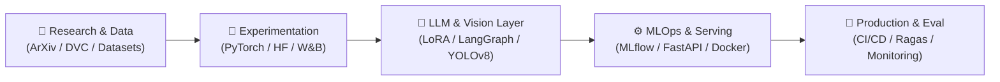

<!-- ==================== ANIMATED HEADER WAVE & TYPING SVG ==================== -->
<div align="center">

  

  <!-- Animated Typing Text -->
  <a href="https://git.io/typing-svg">
    
  </a>

  <br/>

  <!-- Status & Contact Badges -->
  <p align="center">
    
    
    <a href="https://github.com/rjb2k61">
      
    </a>
    <a href="mailto:rijulbhattacharjee@gmail.com">
      
    </a>
    <!-- Uncomment once LinkedIn is created:
    <a href="https://www.linkedin.com/in/YOUR_LINKEDIN">
      
    </a>
    -->
  </p>

</div>

---

<!-- ==================== ABOUT ME (TERMINAL STYLE + BIO) ==================== -->
## 🧠 `whoami` — About Me

```yaml
name: "Rijul Bhattacharjee"
github: "@rjb2k61"
email: "rijulbhattacharjee@gmail.com"
education: "B.Tech in Artificial Intelligence & Machine Learning (2nd Year)"
institution: "CMR Institute of Technology (CMRIT), Bengaluru, India 🇮🇳"
status: "🟢 Aspiring AI/ML Engineer — Open to Work, Internships & Research Collaborations"
core_focus:
  - "Generative AI & LLM Engineering (RAG, Agentic Workflows, Fine-Tuning / PEFT)"
  - "MLOps & End-to-End ML Systems (CI/CD/CT, Model Serving, Experiment Tracking)"
  - "AI/ML Research (Deep Learning Architectures, Computer Vision & Efficient Inference)"
philosophy: "Models in a notebook are experiments; models in production with observability are engineering."
```

Hi there! 👋 I'm **Rijul Bhattacharjee**, a 2nd-year **B.Tech AIML undergraduate at CMRIT Bangalore** driven by the intersection of **foundational AI research** and **production-grade machine learning engineering**.

- 🔬 **Research & Deep Learning:** Exploring transformer internals, parameter-efficient fine-tuning (**LoRA / QLoRA**), computer vision explainability (**Grad-CAM**), and reproducing modern architectures in PyTorch.
- 🤖 **Generative AI & LLMs:** Building grounded **RAG pipelines**, multi-agent orchestration with **LangGraph**, structured LLM outputs, and low-latency inference systems.
- ⚙️ **MLOps & Reliability:** Bridging the gap between Jupyter notebooks and scalable microservices using **Docker, FastAPI, MLflow, Weights & Biases, and DVC**.
- 💼 **Open to Opportunities:** Actively seeking **AI/ML Engineering, GenAI/LLM, MLOps, and Research Roles/Internships** — reach out anytime at **[rijulbhattacharjee@gmail.com](mailto:rijulbhattacharjee@gmail.com)**.

---

<!-- ==================== ANIMATED TECH STACK ==================== -->
## ⚡ Tech Stack & Engineering Arsenal

<div align="center">
  
</div>

<br/>

<table align="center">
  <thead>
    <tr>
      <th align="center">🧬 GenAI & LLM Engineering</th>
      <th align="center">🔥 Deep Learning & Research</th>
      <th align="center">⚙️ MLOps & Deployment</th>
      <th align="center">💻 Core & Data Stack</th>
    </tr>
  </thead>
  <tbody>
    <tr>
      <td align="center">
        <br/>
        <br/>
        <br/>
        <br/>
        <br/>
        
      </td>
      <td align="center">
        <br/>
        <br/>
        <br/>
        <br/>
        <br/>
        
      </td>
      <td align="center">
        <br/>
        <br/>
        <br/>
        <br/>
        <br/>
        
      </td>
      <td align="center">
        <br/>
        <br/>
        <br/>
        <br/>
        <br/>
        
      </td>
    </tr>
  </tbody>
</table>

---

<!-- ==================== FEATURED AI PROJECTS ==================== -->
## 🚀 Featured Project

<div align="center">
  <a href="https://github.com/rjb2k61/Roadwatch---An-AI-powered-pothole-detection-system">
    
  </a>
</div>

- 🛣️ **[RoadWatch — AI-Powered Pothole Detection & Severity Reporting System](https://github.com/rjb2k61/Roadwatch---An-AI-powered-pothole-detection-system)**: Two-stage Computer Vision pipeline combining **MobileNetV2 + Grad-CAM explainability** and **YOLOv8 object localisation** with automated road-damage severity scoring, EXIF GPS mapping, and downloadable PDF/CSV civic inspection reports.

---

<!-- ==================== ARCHITECTURAL WORKFLOW DIAGRAM ==================== -->
## 🔄 How I Build & Ship AI Systems



---

<!-- ==================== GITHUB STATS & ACTIVITY ==================== -->
## 📊 GitHub Analytics & Engineering Pulse

<div align="center">
  
  
</div>

<div align="center">
  
</div>

<div align="center">
  
</div>

---

<!-- ==================== ANIMATED CONTRIBUTION SNAKE ==================== -->
## 🐍 Contribution Grid Snake

<div align="center">
  <picture>
    <source media="(prefers-color-scheme: dark)" srcset="https://raw.githubusercontent.com/rjb2k61/rjb2k61/output/github-contribution-grid-snake-dark.svg" />
    <source media="(prefers-color-scheme: light)" srcset="https://raw.githubusercontent.com/rjb2k61/rjb2k61/output/github-contribution-grid-snake.svg" />
    
  </picture>
</div>

---

<!-- ==================== FOOTER WAVE ==================== -->
<div align="center">
  <h3>🤝 Let's Collaborate on GenAI, MLOps, or AI Research!</h3>
  <p>📫 Reach me directly at <a href="mailto:rijulbhattacharjee@gmail.com"><b>rijulbhattacharjee@gmail.com</b></a></p>

  
</div>
